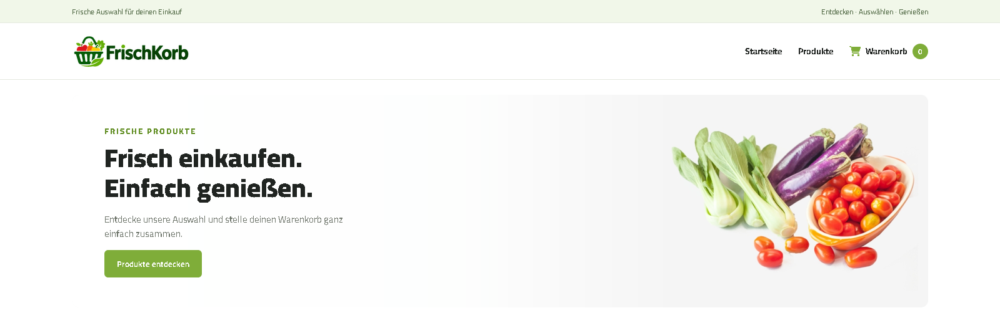
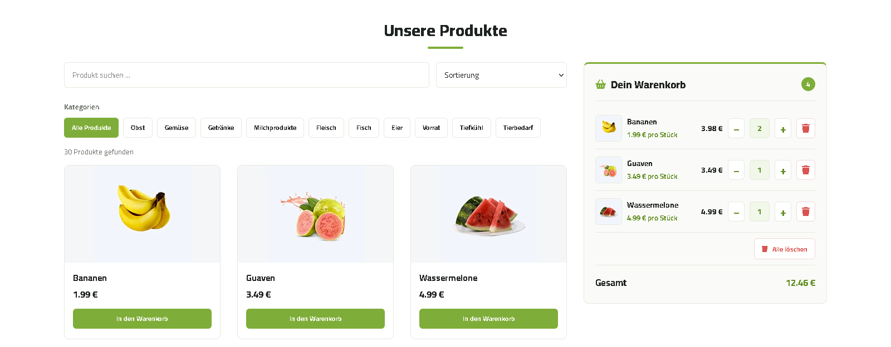

# FrischKorb

FrischKorb ist ein kleiner Online-Shop. Man kann Produkte suchen, nach Kategorien filtern, sortieren und in den Warenkorb legen. Dort lassen sich Mengen ändern, einzelne Artikel entfernen und der Gesamtpreis wird automatisch berechnet.

## Funktionen

- Produkte werden aus einer JSON-Datei geladen
- Suche nach Produktnamen und Filter nach Kategorien
- Sortieren nach Name oder Preis
- Warenkorb mit Plus, Minus und Löschen
- **Alle löschen** erscheint, sobald mehr als zwei verschiedene Produkte im Warenkorb liegen
- Gesamtpreis wird automatisch berechnet
- Warenkorb bleibt durch LocalStorage auch nach dem Neuladen gespeichert

## Screenshots

**Startseite**

**Produktübersicht mit Suche, Sortierung und Kategorien**

**Warenkorb mit drei verschiedenen Produkten und „Alle löschen“**

## Technologien

HTML, CSS, Bootstrap, JavaScript, JSON, XMLHttpRequest und Font Awesome.

## Projekt starten

Den Ordner in VS Code öffnen und `index.html` mit **Live Server** starten. Die Produkte kommen aus `data/products.json`, deshalb funktioniert das Laden nicht direkt über `file://`.

## Dateien

- `index.html` – die Seite
- `js/main.js` – JavaScript für Produkte und Warenkorb
- `data/products.json` – Produktliste
- `css/`, `assets/` und `img/` – Design, Icons und Bilder
