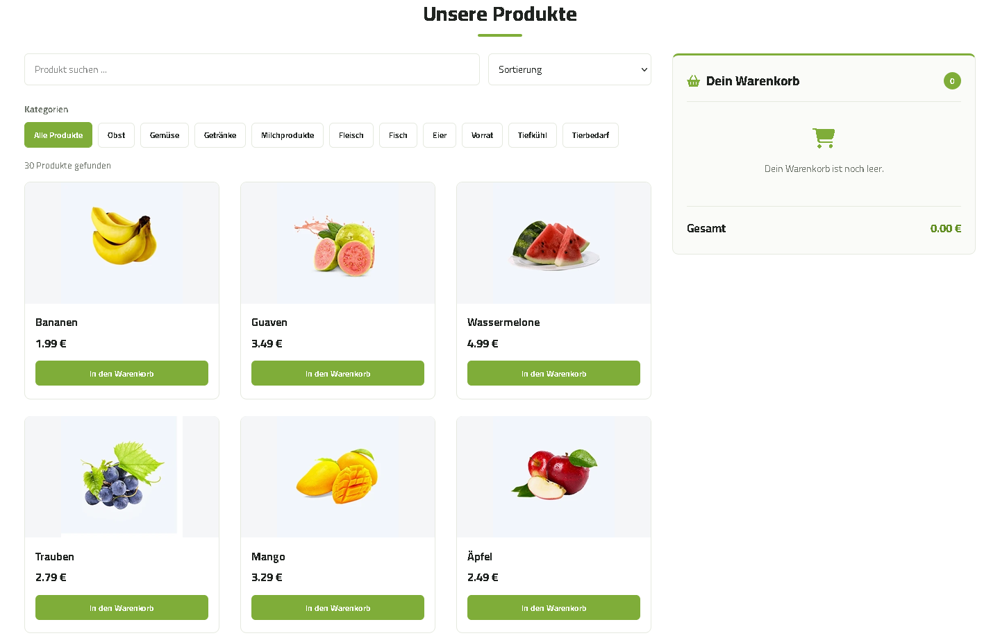

# FrischKorb

FrischKorb ist mein Projekt aus dem JavaScript- und AJAX-Kurs. Ich wollte einen kleinen Shop bauen, in dem man Produkte suchen und einen Warenkorb zusammenstellen kann.

## Funktionen

- Produkte werden aus einer JSON-Datei geladen
- Suche nach Produktnamen und Filter nach Kategorien
- Sortieren nach Name oder Preis
- Warenkorb mit Plus, Minus und Löschen
- Gesamtpreis wird automatisch berechnet
- Warenkorb bleibt durch LocalStorage auch nach dem Neuladen gespeichert

## Screenshots

**Startseite**

**Produktübersicht**

**Warenkorb**

## Technologien

HTML, CSS, Bootstrap, JavaScript, JSON, XMLHttpRequest und Font Awesome.

## Projekt starten

Den Ordner in VS Code öffnen und `index.html` mit **Live Server** starten. Die Produkte kommen aus `data/products.json`, deshalb funktioniert das Laden nicht direkt über `file://`.

## Dateien

- `index.html` – die Seite
- `js/main.js` – JavaScript für Produkte und Warenkorb
- `data/products.json` – Produktliste
- `css/`, `assets/` und `img/` – Design, Icons und Bilder

*Für das Grundlayout habe ich Elemente aus dem Ogani-Template von Colorlib angepasst.*
